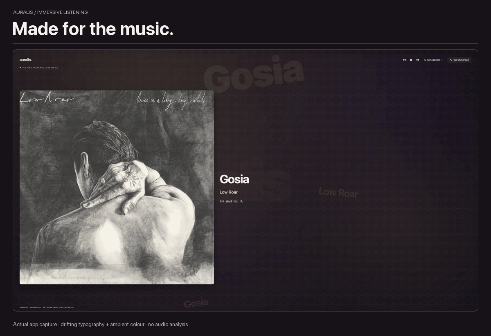
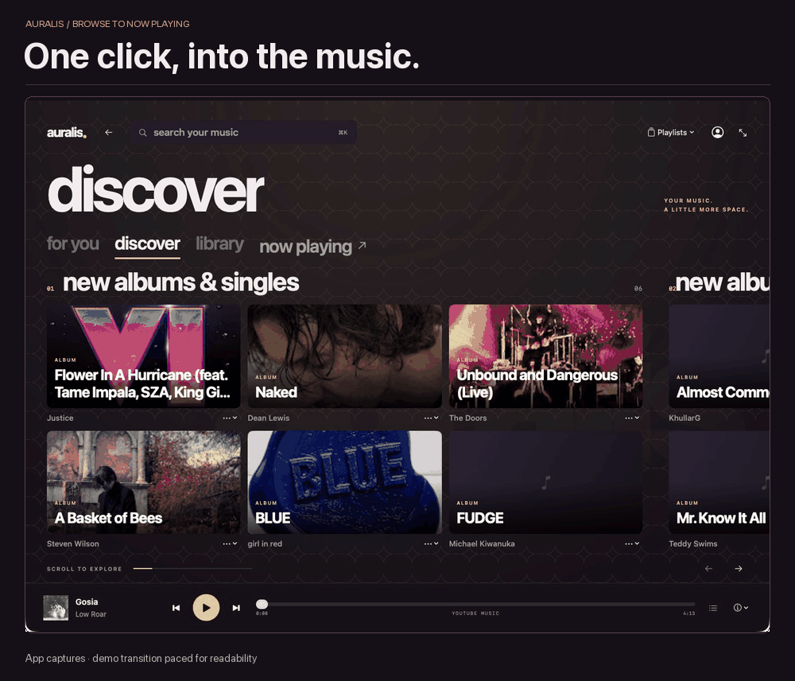

<div align="center">

# auralis.

**Your music. A little more space.**

A native macOS YouTube Music player with oversized type, a horizontal panorama,
living artwork and an immersive listening room. Inspired by the spirit of Zune.

**Apple Silicon · macOS 14+ · SwiftUI + AppKit + WebKit**

[Build locally](#build-and-run) · [How it works](docs/Architecture.md) · [Validation](docs/Validation.md)

</div>



## A listening room, made for the Mac

Big artwork. Bold typography. A little space for the music to breathe. Auralis brings a native landscape around the real YouTube Music player, with one persistent in-app session and one transport.

- **A panorama to explore.** Browse sideways through your music with layered parallax, large pivots and artwork-first live tiles.
- **Stay in the app.** Google sign-in and first-party playback live in the same persistent WKWebView. No browser companion or extension.
- **Follow the music.** Open artists, albums and playlists, see the actual Up next queue, and start a provider radio/mix.
- **Go immersive.** Full screen gives the artwork and drifting typography the room. Choose artwork colours, Aurora, Ribbons or Still.
- **Words with a source.** Optional rendered YouTube Music lyrics or attributed Wikipedia artist context; unavailable sources fall back to track typography.
- **Quiet when it should be.** Decorative movement respects Reduce Motion, Low Power Mode and app inactivity. Listening-room motion also follows playback state.



The GIFs are silent captures of the running app, resized, trimmed and looped with presentation captions. The navigation demo holds both screens and uses an edited dissolve for readability. They are not frame-rate benchmarks. Artwork belongs to its respective owners. [Static immersive preview](docs/media/immersive-poster.png) · [Static Browse preview](docs/media/navigation-poster.png)

## Build and run

Requires an Apple Silicon Mac running macOS 14+, with Xcode or Apple's Command Line Tools and a macOS 14+ SDK. There are no third-party runtime dependencies.

```sh
git clone https://github.com/akshatdhabi/auralis.git
cd auralis
./Scripts/build.sh
open "build/Auralis Native.app"
```

Or open `Auralis.xcodeproj`, choose **Auralis → My Mac**, and Run. The project and shared XCTest scheme are checked in; `Scripts/generate-project.py` regenerates them deterministically.

Sign in with Google inside the app when prompted. Login and player share `WKWebsiteDataStore.default()`. The current development identity remains `studio.auralis.signin-spike` to preserve existing installations' website sessions without transferring cookies. Run one Auralis build at a time.

## Find your way around

| Action | Control |
| --- | --- |
| Search | **⌘K** |
| Browse / Now Playing | **⌘1** / **⌘2** |
| Open the current track | Click the bottom-left artwork or title |
| Move across the panorama | Trackpad, vertical mouse wheel, or rail arrows |
| Start current-track radio | **⌘⇧R** or **start mix** |
| System full screen | **⌃⌘F** |
| Immersive listening | Screen icon or **Atmosphere → Immersive full screen** |
| Leave immersion | **Escape** or **Exit immersion** |

Playlists sit in the top-right menu. Up next keeps its own vertical song list. Artist/album links and contextual menus use the provider's existing controls. If a page or action is unavailable, the full first-party website can open inside the app.

## Checks

Node.js is needed only for the JavaScript fixtures.

```sh
./Scripts/check.sh
```

This runs twelve core state/decoder checks, artwork transport/cache fixtures, playback/browse/radio/queue/lyrics fixtures, syntax checks, an optimized arm64 build with warnings treated as errors, and strict ad-hoc signature verification. GitHub Actions also runs hosted XCTest on an Apple Silicon macOS runner. See the [test record](docs/Validation.md) for current results and remaining checks.

## Honest boundaries

Auralis is an unofficial development preview. YouTube Music controls streaming, ads, account entitlements and audio quality. No bitrate or quality tier is measured or forced; no lossless or bit-perfect claim is made.

The visuals use **time, theme and observed playback state**. They do not analyze audio: no FFT, beat detection, microphone, system recording or streaming extraction. Lyrics are **not synchronized**. Wikipedia context is opt-in and attributed. No password capture, cookie export, private streaming API, DRM bypass or ad blocking is implemented.

Catalog, queue and optional lyrics depend on currently rendered first-party content. Provider changes can affect compatibility. Artwork uses bounded memory/disk caches; new thumbnails still depend on the source and network. The build is ad-hoc signed; Developer ID signing/notarization and the wider release matrix remain future work.

[Architecture](docs/Architecture.md) · [Integration and quality](docs/Integration.md) · [Attribution](docs/Attribution.md) · [Naming explorations](docs/Branding.md)
