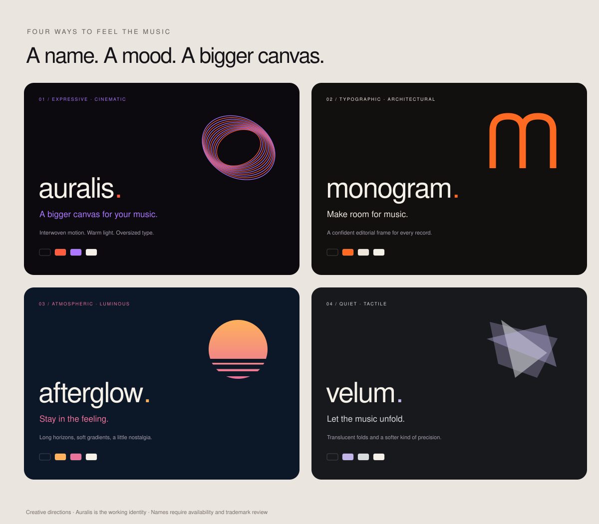

# Four naming and identity directions

These are conceptual creative directions. Names have not been cleared for trademarks, app-store availability or domains.

| Name | Character | Palette | Mark idea | Product line |
|---|---|---|---|---|
| **Auralis** · working identity | Warm, expressive, cinematic | Ink `#0C0A0F`, coral `#FF5C3D`, violet `#AB78FF`, ivory `#F5F0E8` | Interwoven elliptical rings; a coral terminal dot | A bigger canvas for your music. |
| **Monogram** | Confident, typographic, architectural | Near-black `#11100F`, ivory `#EEE8DC`, signal orange `#FF6A22` | Cropped lowercase m, built from tall strokes | Make room for music. |
| **Afterglow** | Atmospheric, luminous, late-night | Midnight `#0C1727`, amber `#FFB15C`, rose `#EB729A` | A setting disc with a thin light horizon | Stay in the feeling. |
| **Velum** | Quiet, tactile, precise | Graphite `#17191D`, silver `#D8DCDD`, lilac `#C1B4E8` | Offset translucent folds | Let the music unfold. |

## Current visual direction

Auralis remains the working name. The native window uses oversized light typography, intact album artwork, ink backgrounds and an artwork-derived accent. Aurora, Ribbons and Still are ambient treatments; none analyze audio.

All four directions describe the same single-app experience: sign in inside the app, browse YouTube Music and switch to the native stage. The app has no companion onboarding. A final public rename should keep the existing WebKit application identity stable or explicitly plan a fresh sign-in; it must not move cookie values.
